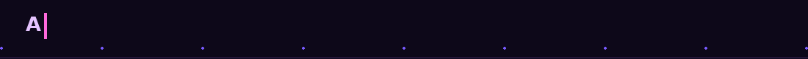
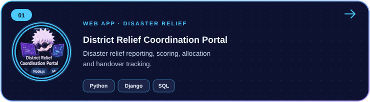
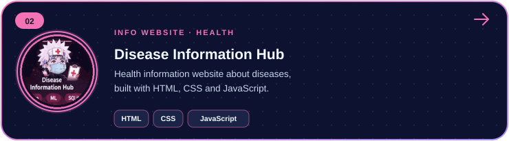
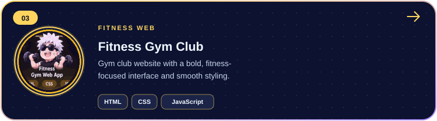
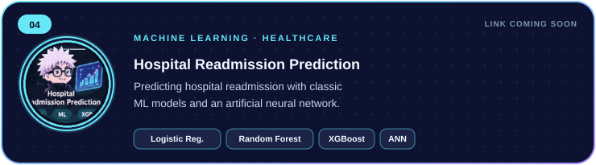
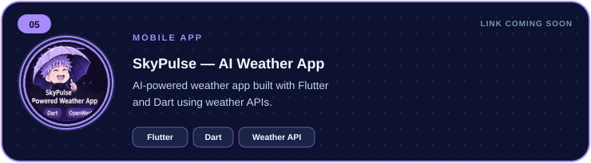
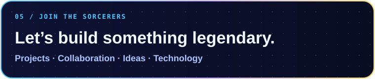

<b><a href="https://github.com/morgancodes09">GITHUB · @morgancodes09</a></b> &nbsp; ✦ &nbsp; KIET GROUP OF INSTITUTIONS &nbsp; ✦ &nbsp; B.TECH CSIT &nbsp; ✦ &nbsp; 3RD YEAR · SEMESTER 5

*“Turning curiosity into code, and ideas into real-world solutions.”*

---

## 🌀 About Abhay

## ✨ Skill Constellation

Technologies are taken from project descriptions and learning areas; this is not a claim of expert-level proficiency.

## 🪪 Developer ID & Power Level Dashboard

## 🚀 Featured Missions

## 🗂️ Repository Collection

**5 featured projects · 2 project lanes · one growing portfolio.** Select any illustrated card to open its GitHub repository (where available).

### 🧠 Web, Data & AI Builds

<table>
<tr><td width="50%" align="center"></td><td width="50%" align="center"></td></tr>
<tr><td width="50%" align="center"></td><td width="50%" align="center"></td></tr>
<tr><td width="50%" align="center"></td><td width="50%" align="center"></td></tr>
</table>

<a href="https://github.com/morgancodes09?tab=repositories"><b>✦ Explore all repositories on GitHub →</b></a>

New project? Add its SVG card to the repository root and include its linked image in the grid above.

## 🎮 Hobbies & Interests

## 📊 Cursed Energy Stats

 Live cards use public GitHub Readme Stats and may be rate-limited briefly.

## 🌃 Contribution Skyline

Generated by the repository's GitHub Actions workflow. It updates on schedule after the workflow runs successfully.

## 🐍 Contribution Snake

Published to the <code>output</code> branch by the same workflow run.

## 💌 Connect

<table width="100%">
<tr>
<td width="38%" align="center" valign="middle">

</td>
<td width="62%" valign="middle">

 

</td>
</tr>
</table>

**Code · Learn · Create · Grow**  

