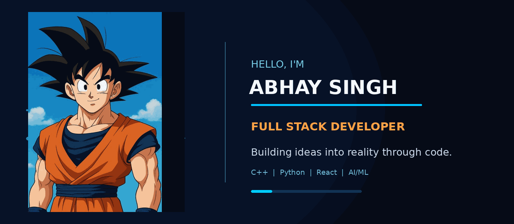

<!-- GOKU HERO: animated GIF banner -->

 

 

---
🟠 My Saiyan Way | About Me
🎓 B.Tech student in Computer Science & IT at KIET Group of Institutions.
💻 Interested in Full Stack Development, software engineering and problem solving.
🤖 Exploring Artificial Intelligence, Machine Learning and Deep Learning.
🧠 Practising Data Structures & Algorithms and improving my coding skills.
🚀 I enjoy building practical projects and learning new technologies.
🎯 Goal: become a skilled software engineer and build useful, scalable products.
⭐ Beyond Code | Interests
🏏 Cricket & badminton
🎮 Gaming
🎌 Anime — especially Dragon Ball
💪 Fitness and gym
⚡ Jutsu Arsenal | Tech Stack

Programming

Frontend & App Development

AI / ML & Data

Tools, Cloud & Databases

🪪 Saiyan ID Card
	
GitHub	@morgancodes09
Education	B.Tech — Computer Science & IT
Institution	KIET Group of Institutions, Ghaziabad
Interests	Full Stack · AI/ML · DSA · Cloud
Currently learning	DSA, Deep Learning and software development
🐉 Featured Projects | S-Rank Missions
Project	Description	Tech / Focus
Hospital Readmission Prediction	ML-based prediction of patient readmission risk	Python, ML, Random Forest, XGBoost, ANN
SkyPulse	AI-powered weather application	Flutter, Dart, APIs
Smart Student Organizer	Student productivity app for tasks, schedules and notes	Flutter
IoT Blind Stick	Assistive technology prototype using sensors	IoT, Sensors
Fitness Gym Web App	Gym and fitness management website	HTML, CSS, JavaScript
> Add each project's GitHub repository link to its name once the project repository is public.
📊 GitHub Dashboard

🌌 My Contribution Village

🔥 Let's Connect

KEEP CODING · KEEP GROWING · KAMEHAMEHA! ⚡

